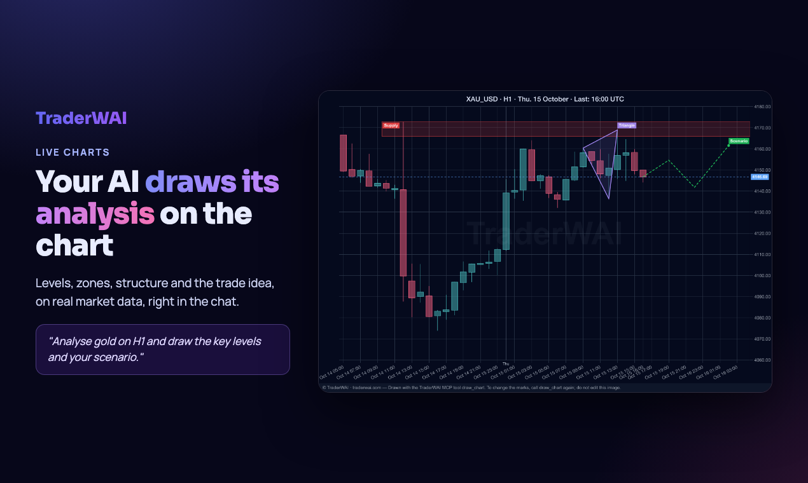

<p align="center"></p>

# TraderWAI Charts

Live trading charts, exact market data, strategy backtests and a read-only view of your broker accounts inside your AI (Gemini CLI, Cline, Cursor or any MCP client), from [TraderWAI](https://traderwai.com).

Remote MCP server: `https://mcp.traderwai.com/charts/v2` (Streamable HTTP, OAuth 2.1 with dynamic client registration). Nothing to install or run locally.



- **Charts:** candlestick images for 40 symbols (major and cross forex pairs, gold, silver, oil, natural gas, stock indices, index and energy futures, Bitcoin and Ethereum), from 1 minute to monthly.
- **Marked charts:** The AI draws its analysis on a real chart: support and resistance, zones, trend lines, entry, stop and targets.
- **Exact data:** OHLC candles and the latest price, so the levels in the analysis are precise.
- **Your accounts (read-only):** see the broker accounts you connected to TraderWAI (MetaTrader 4/5, cTrader, TradeLocker, Match-Trader, DXtrade, Capital.com, Binance, Bybit) with balance, equity and open positions.
- **Backtests:** describe a rule in plain language (range breakouts, moving average or level crosses, fair value gap retests, liquidity sweeps, time windows) and get every trade, the win rate, the total result in R and the drawdown.

TraderWAI Charts is **read-only**: it can read the accounts you connected, but it cannot place, modify or close orders and never moves money.

## Install

### Gemini CLI

```bash
gemini extensions install https://github.com/leonardo-mazzitelli/traderwai-charts
```

Then start Gemini CLI and sign in once with your TraderWAI account (free to create):

```
/mcp auth traderwai-charts
```

### Cline, Cursor and other MCP clients

Add the remote server to your MCP settings:

```json
{
  "mcpServers": {
    "traderwai-charts": {
      "url": "https://mcp.traderwai.com/charts/v2",
      "type": "streamableHttp"
    }
  }
}
```

On first use your client opens the TraderWAI sign-in in the browser (free account, Google sign-in). No API key needed.

## Try it

- `Show me the gold chart on H4 and mark the key levels`
- `Analyze EUR/USD on the daily and hourly charts`
- `Backtest buying the London open range breakout on GBP/USD M15 over the last 7 days`

## Tools

| Tool | What it does |
|---|---|
| `get_chart` | Candlestick chart image for a symbol and timeframe |
| `draw_chart` | Chart image with the analysis drawn on it |
| `get_ohlc` | Exact OHLC candles |
| `get_quote` | Latest price |
| `backtest_strategy` | Backtest of a rule-based strategy on historical data |
| `list_symbols` / `list_timeframes` | Available markets and timeframes |
| `list_supported_platforms` | Brokers and platforms TraderWAI connects to |
| `get_broker_accounts` | Your connected broker accounts (read-only) |
| `get_positions` | Open positions on your connected accounts (read-only) |

Viewing charts and data is unlimited. Marked charts and backtests have daily limits on the free account.

## Links

- Documentation: https://traderwai.com/en/docs
- Status: https://traderwai.com/en/status
- Privacy: https://traderwai.com/en/privacy · Terms: https://traderwai.com/en/terms
- Support: info@traderwai.com

Analyses and backtests are educational and are not investment advice. Past results do not guarantee future results.

© FLEXIN AGILE LTD. Documentation licensed under CC BY 4.0.
